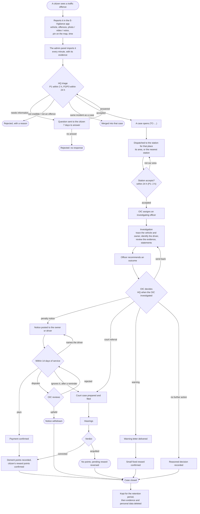
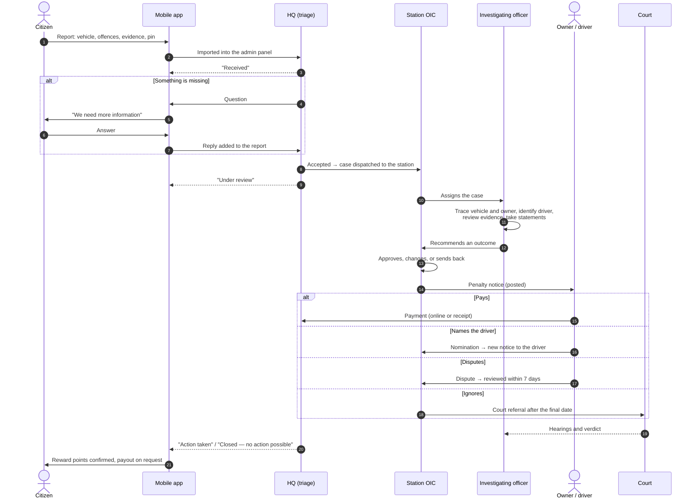
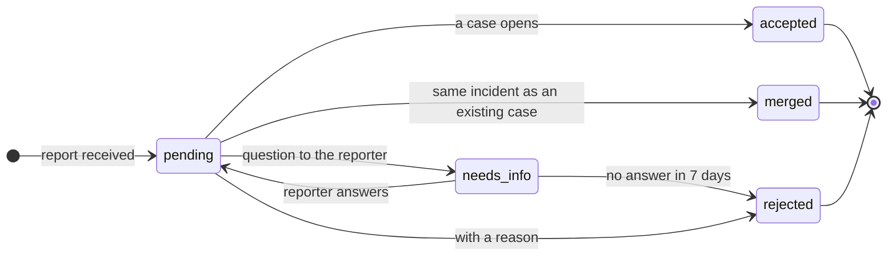
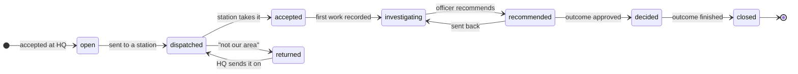
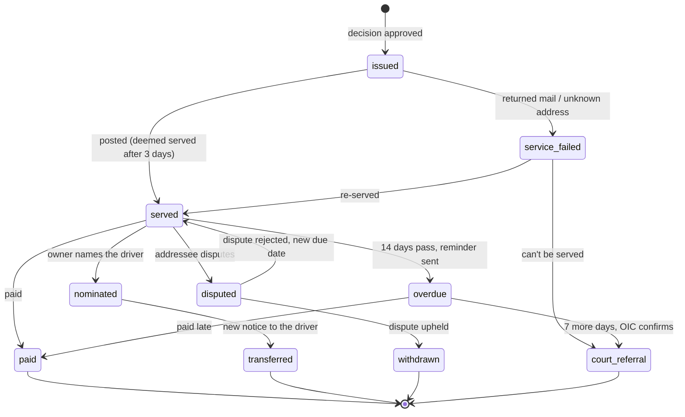
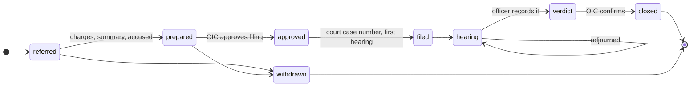
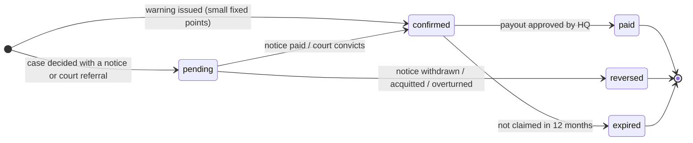

# 23 — The story of a report, from the street to the end

**Status:** Reference · **Depends on:** 02–11, 16 · **Last updated:** 2026-10-27

One picture of the whole journey: a citizen sees a traffic offence, reports it in the mobile app,
and the police take it all the way to an end — a paid fine, a court verdict, a warning, or a
reasoned decision to take no action — with the citizen kept informed and rewarded when the tip
proves right. Each chapter below opens one part of the picture; the detailed rules are in the
documents it links to.

The diagrams are [Mermaid](https://mermaid.js.org/); GitHub and VS Code (with a Mermaid preview)
draw them.

## 1. The whole story in one picture

At every step the citizen sees a short, privacy-safe update in the app (chapter 9).

## 2. Who does what

## 3. Chapter 1 — The citizen reports ([11](11-citizen-app-integration.md))

The citizen fills in the app's report wizard:

| Step | What they give | Checks |
|---|---|---|
| Vehicle | Plate (or "plate unknown"), type, description | The plate is read as a Sri Lankan plate; if not, the report is flagged |
| Offences | One or more offences from the police offence schedule | Only offences that apply to that vehicle type are offered (no "no helmet" for a car) |
| Evidence | Photos, video, voice note | Files captured outside the app are flagged for triage |
| Place | A pin: GPS, the photo's location, a map search, a Google Maps link, or coordinates | The pin must be in Sri Lanka and confirmed; it picks the police station |
| Time | When it happened | More than 30 days ago can't be acted on |

The admin panel imports new app reports **every minute**. Evidence is copied from the shared
storage; if a file can't be copied yet, the report is flagged and the copy is retried (1, 5, 15,
60, 360 minutes, up to 12 tries) — never twice.

## 4. Chapter 2 — HQ triage ([02](02-reports-and-triage.md))

Every report waits in HQ's **Triage** queue (Reports → Triage), highest priority and oldest first.
One HQ user works a report at a time (a 15-minute lock).

| Limit | Default |
|---|---|
| Triage a P1 report | 2 hours |
| Triage a P2 / P3 report | 24 hours |
| Reporter answers a question | 7 days |

Reasons a report can be rejected: not an offence we can act on, not enough evidence, vehicle
can't be identified, outside Sri Lanka Police's area, more than 30 days old, fabricated, abusive,
not a traffic matter, no response — and, for the app only, a suspended account.

> Reports from officers on duty skip HQ triage: a **second officer** must confirm them before the
> case opens (status `awaiting_second_officer`).

## 5. Chapter 3 — The case reaches a station ([03](03-cases-and-dispatch.md))

Accepting a report opens a **case** (`TC-YYYY-NNNNNN`) — the police's own record. The report stays
as what the citizen said; what the police conclude goes on the case.

The station is chosen from the pin: the station whose drawn area contains it, otherwise the
**nearest** verified station; HQ can choose one by hand, with a reason.

| Limit | Default (P1) |
|---|---|
| Station accepts a dispatch | 24 h (2 h) |
| Work starts after dispatch | 72 h (24 h) |
| OIC assigns an investigating officer | 24 h after accepting |
| Recommendation after acceptance | 7 days |
| Decision after recommendation | 3 days |

A missed limit alerts the person responsible and their OIC; at twice the limit, HQ.

## 6. Chapter 4 — Investigation and the decision ([04](04-investigation-vehicles-and-people.md), [05](05-outcomes-and-penalty-notices.md))

The investigating officer:

1. **Traces the vehicle** — enters the registered owner from the vehicle registry.
2. **Identifies the driver**, when known, and on what basis.
3. **Reviews the evidence** — a yes/no checklist: plate readable, vehicle matches, time and place
   consistent, no signs of editing, offence visible.
4. Takes **statements** and adds **more evidence** if needed.
5. **Recommends an outcome.** The panel shows which outcomes are ready and what each still needs.

The **OIC** decides (HQ decides when the OIC was the investigating officer): approve, change the
outcome with a reason, or send it back for more work.

| Outcome | When it can be chosen |
|---|---|
| **Penalty notice** | Every confirmed offence carries a fine; an addressee with an address; evidence reviewed |
| **Court referral** | Serious offences, or when a notice can't work |
| **Warning** | Minor offences only, and no enforcement against the person in the last 12 months |
| **No further action** | With a reason (e.g. driver can't be identified) |

## 7. Chapter 5 — The penalty notice ([05](05-outcomes-and-penalty-notices.md), [07](07-payments-and-simulator.md))

The notice is addressed to the owner (or the identified driver). The fines are copied from the
offence schedule on the day it is issued.

| Limit | Default |
|---|---|
| Notice posted after the decision | 3 days |
| Deemed served after posting | 3 days |
| Pay, name the driver, or dispute | 14 days from service |
| Final date after the reminder | 7 more days |
| OIC reviews a dispute | 7 days |

**Paying:** online (card or wallet — simulated until a real gateway is connected), or at a cash
agent, post office or bank, where the receipt is recorded and HQ checks it within 3 days. HQ can
approve a refund when a paid notice is withdrawn.

## 8. Chapter 6 — Court ([06](06-court-cases.md))

A matter reaches court three ways: the decision was **court referral**, a notice went **unpaid**,
or a notice **couldn't be served**.

The case goes to the Magistrate's Court for the place (the station's court). The prosecuting
officer prepares it within 14 days, files it within 14 days of approval, is reminded 3 days before
each hearing, and records each hearing's outcome within 2 days.

## 9. Chapter 7 — What the citizen sees ([11](11-citizen-app-integration.md))

The citizen never sees the offender's name, address or anything private — only where their report
stands.

| When | The app shows |
|---|---|
| Imported | **Received** — "Thank you. Your report has been received and will be checked." |
| HQ asks a question | **We need more information** — the question, with a reply box |
| Accepted | **Under review** — "Your report is being looked into." |
| Rejected | **Closed** — the reason, in plain words |
| Enforcement (notice, court, warning) | **Action taken** — "The police have taken action on what you reported." |
| No further action | **Closed — no action possible** |

## 10. Chapter 8 — Rewards for the citizen ([16](16-citizen-rewards.md))

- A case earns the points of its **highest** offence (not the sum).
- **100 points = Rs 1,000**; a payout needs at least 100 confirmed points; HQ reviews each payout
  (fraud checks) before it is paid.
- Only the first **10** reports a day can earn points. No action or a rejected report earns
  nothing; false reporters can be flagged or suspended.

## 11. Chapter 9 — After the outcome ([08](08-demerit-points.md), [10](10-evidence-audit-and-privacy.md))

**Demerit points** go on the driver's record (or the owner's, if they paid without naming a driver)
when a notice is **paid** or the court **convicts** — the sum of the case's offences. At **16**
points the driver gets a warning flag; at **24**, HQ is told to refer the driver to the Department
of Motor Traffic. Organisations get no points but must name the driver.

**Retention** — nothing personal is kept for ever:

| Record | Kept for | Then |
|---|---|---|
| Case closed with no further action | 2 years after closing | Evidence deleted, personal data anonymised |
| Case with a paid notice or a warning | 7 years after closing | Evidence and personal data deleted |
| Court case | 10 years after the final verdict | Evidence and personal data deleted |
| Audit log | 10 years | Deleted |

Every action along the way — who did it, when, and why — is in the **audit log**.
